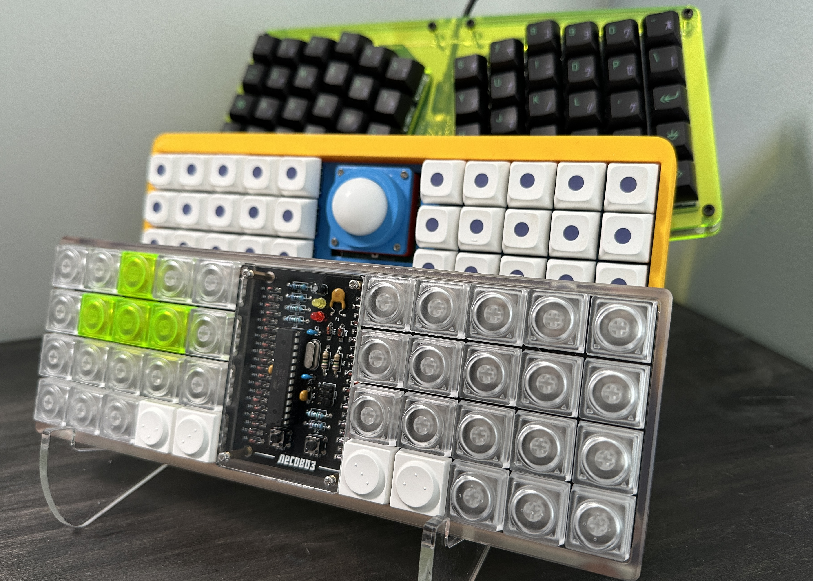

# Mechanical Keyboards

Hey ya'll! This is a small repository where I keep all my configuration files for various keyboards, macropads, and oddities. I've had varying keyboards in the past, but have finally settled on the 40% layout.

# Keymaps 
Since I have finally delved into the 40s life I've had to really focus on curating layers and keymaps that included everything I needed and exists in places that make sense to me. 

Note: My QWERTY layer includes HRMs CAGS/⎈⎇◆⇧

### QWERTY

```
      q  │  w  │  e  │  r  │  t          y  │  u  │  i  │  o  │  p  
    ─────┼─────┼─────┼─────┼─────      ─────┼─────┼─────┼─────┼─────
      a  │  s  │  d  │  f  │  g          h  │  j  │  k  │  l  │  ;  
    ─────┼─────┼─────┼─────┼─────      ─────┼─────┼─────┼─────┼─────
      z  │  x  │  c  │  v  │  b          n  │  m  │  ,  │  .  │  /  
    ─────┴─────┴─────┴─────┴─────      ─────┴─────┴─────┴─────┴─────
                ─────┌─────┬─────┐    ┌─────┬─────┐──────
                LLCK │ Del │ Bspc│    │ Spc │ Spc │  LLCK
                ─────└─────┴─────┘    └─────┴─────┘──────
```

### NUMPAD

```
         │     │  ↑  │     │            NUM │  7  │  8  │  9  │  -  
    ─────┼─────┼─────┼─────┼─────      ─────┼─────┼─────┼─────┼─────
         │  ←  │  ↓  │  →  │             /  │  4  │  5  │  6  │  +  
    ─────┼─────┼─────┼─────┼─────      ─────┼─────┼─────┼─────┼─────
         │     │     │     │             *  │  1  │  2  │  3  │  .  
    ─────┴─────┴─────┴─────┴─────      ─────┴─────┴─────┴─────┴─────
                ─────┌─────┬─────┐    ┌─────┬─────┐──────
                TRNS │     │     │    │  =  │  0  │  TRNS
                ─────└─────┴─────┘    └─────┴─────┘──────
```

### NAVI

```
         │     │     │     │           HOME │PGDN │PGUP │ END │     
    ─────┼─────┼─────┼─────┼─────      ─────┼─────┼─────┼─────┼─────
         │     │ MS2 │ MS1 │             ←  │  ↓  │  ↑  │  →  │     
    ─────┼─────┼─────┼─────┼─────      ─────┼─────┼─────┼─────┼─────
         │     │     │     │                │     │     │     │     
    ─────┴─────┴─────┴─────┴─────      ─────┴─────┴─────┴─────┴─────
                ─────┌─────┬─────┐    ┌─────┬─────┐──────
                TRNS │     │     │    │     │     │  TRNS
                ─────└─────┴─────┘    └─────┴─────┘──────
```

### SYMBOLS

```
      !  │  @  │  #  │  $  │  %          ^  │  &  │  *  │     │     
    ─────┼─────┼─────┼─────┼─────      ─────┼─────┼─────┼─────┼─────
      (  │  <  │  [  │  {  │  `          ~  │  }  │  ]  │  >  │  )  
    ─────┼─────┼─────┼─────┼─────      ─────┼─────┼─────┼─────┼─────
      ;  │  :  │  '  │  "  │  b          -  │  _  │  \  │  |  │  /  
    ─────┴─────┴─────┴─────┴─────      ─────┴─────┴─────┴─────┴─────
                ─────┌─────┬─────┐    ┌─────┬─────┐──────
                TRNS │     │     │    │     │     │  TRNS
                ─────└─────┴─────┘    └─────┴─────┘──────
```

### FUNC

```
         │     │     │     │                │  F1 │  F2 │  F3 │  F4    
    ─────┼─────┼─────┼─────┼─────      ─────┼─────┼─────┼─────┼─────
         │     │     │     │                │  F5 │  F6 │  F7 │  F8  
    ─────┼─────┼─────┼─────┼─────      ─────┼─────┼─────┼─────┼─────
         │     │     │     │                │  F9 │ F10 │ F11 │ F12  
    ─────┴─────┴─────┴─────┴─────      ─────┴─────┴─────┴─────┴─────
                ─────┌─────┬─────┐    ┌─────┬─────┐──────
                TRNS │     │     │    │     │     │  TRNS
                ─────└─────┴─────┘    └─────┴─────┘──────
```

## Howto configure your build targets

1. Run the normal `qmk setup` procedure if you haven't already done so -- see [QMK Docs](https://docs.qmk.fm/#/newbs) for details.
1. Fork this repository
1. Clone your fork to your local machine
1. Enable userspace in QMK config using `qmk config user.overlay_dir="$(realpath qmk_userspace)"`
1. Add a new keymap for your board using `qmk new-keymap`
    * This will create a new keymap in the `keyboards` directory, in the same location that would normally be used in the main QMK repository. For example, if you wanted to add a keymap for the Planck, it will be created in `keyboards/planck/keymaps/<your keymap name>`
    * You can also create a new keymap using `qmk new-keymap -kb <your_keyboard> -km <your_keymap>`
    * Alternatively, add your keymap manually by placing it in the location specified above.
    * `layouts/<layout name>/<your keymap name>/keymap.*` is also supported if you prefer the layout system
1. Add your keymap(s) to the build by running `qmk userspace-add -kb <your_keyboard> -km <your_keymap>`
    * This will automatically update your `qmk.json` file
    * Corresponding `qmk userspace-remove -kb <your_keyboard> -km <your_keymap>` will delete it
    * Listing the build targets can be done with `qmk userspace-list`
1. Commit your changes

## Howto build locally

1. Run the normal `qmk setup` procedure if you haven't already done so -- see [QMK Docs](https://docs.qmk.fm/#/newbs) for details.
1. Fork this repository
1. Clone your fork to your local machine
1. `cd` into this repository's clone directory
1. Set global userspace path: `qmk config user.overlay_dir="$(realpath .)"` -- you MUST be located in the cloned userspace location for this to work correctly
    * This will be automatically detected if you've `cd`ed into your userspace repository, but the above makes your userspace available regardless of your shell location.
1. Compile normally: `qmk compile -kb your_keyboard -km your_keymap` or `make your_keyboard:your_keymap`

Alternatively, if you configured your build targets above, you can use `qmk userspace-compile` to build all of your userspace targets at once.